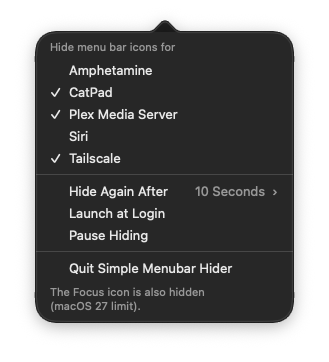

<div align="center">

# Simple Menubar Hider

Hide the menu bar icons you don't need. Click once to see them again.

**Made for macOS 27.** macOS 27 broke the method Bartender, Ice and Hidden Bar used to hide icons.

[Download](https://github.com/wizdes/SimpleMenubarHider/releases/latest) · [Website](https://yili.dev/projects/smh/) · [How it works](#how-it-works)

  

</div>

<div align="center">

<table>
<tr>
<td align="center">
<br>
Before
</td>
</tr>
<tr>
<td align="center">
<br>
After
</td>
</tr>
<tr>
<td align="center">
<br>
Left-click: icons show until the delay ends
</td>
</tr>
</table>

</div>

## Why

macOS 27 broke the method Bartender, Ice and Hidden Bar used to hide icons. Thaw works on macOS 27 but has many features. Simple Menubar Hider (SMH) does one thing: it hides the icons you pick and shows them again with one click.

## Install

Requirements: macOS 27 or later, on a Mac with Apple silicon. The app does not run on Intel Macs.

1. Download the zip from [GitHub Releases](https://github.com/wizdes/SimpleMenubarHider/releases/latest) and unzip it.
2. Move `Simple Menubar Hider.app` to `/Applications`. SMH will not hide icons when run from elsewhere.
3. Open the app. A circle icon appears in the menu bar, and the popover opens by itself the first time.
4. In the popover, click **Open Accessibility Settings** and turn on Simple Menubar Hider. SMH needs this to list apps with menu bar icons. Hiding itself does not use Accessibility.
5. Tick the apps whose icons you want to hide.

The app is signed and notarized by Apple, so it opens without a Gatekeeper warning.

## Use

Right-click (or Control-click) the circle icon to open the popover. Tick the apps you want to hide. Left-click the circle to show the hidden icons. They hide again when the delay ends. Set the delay with Hide Again After; the default is 10 seconds.

The popover also has Launch at Login, Pause Hiding and Quit Simple Menubar Hider.

| Click | What happens |
| ----- | ------------ |
| Right-click or Control-click the circle | Opens the popover to pick apps |
| Left-click the circle | Shows hidden icons until the delay ends |
| Left-click again while they show | Hides them again at once |

<div align="center">
<br>
Right-click the circle to pick apps
</div>

## Permissions and privacy

SMH asks for Accessibility access. It uses Accessibility only to list apps with menu bar icons. Hiding itself does not use it.

SMH does not use the network. It has no tracking and no analytics. It is free and open source.

## FAQ

<details><summary>Why is the Focus (moon) icon hidden too?</summary>

Any hiding also hides the Focus icon. This is a macOS 27 limit. SMH cannot keep it.

</details>

<details><summary>What happens if SMH quits or crashes?</summary>

macOS shows every icon again. Nothing stays hidden without SMH running.

</details>

<details><summary>An app has two icons, can I hide just one?</summary>

No. Hiding is per app. Both icons hide or both stay.

</details>

<details><summary>Does it work with Bartender, Ice, Hidden Bar or Thaw?</summary>

No. SMH pauses hiding while any of those runs. Running two hiders at once would conflict.

</details>

<details><summary>What if a macOS update breaks it?</summary>

SMH uses a private Apple API. If an update stops it from working, SMH hides nothing and shows a warning.

</details>

<details><summary>Why won't it hide anything?</summary>

Check these in order:

- The app runs from `/Applications`.
- At least one app is ticked in the popover.
- Pause Hiding is off.
- No other hider runs. If one does, the Pause row names it.
- The popover shows no warning. If a macOS update broke the private API, SMH hides nothing and says so there.

</details>

## Known limits

- Hiding is per app. If an app has two menu bar icons, both hide or both stay.
- Hiding has been tested on macOS 27 only. Later macOS releases may change the private API.
- The Focus icon is also hidden while hiding is on (macOS 27 limit).
- Icons from programs without a bundle id also hide while hiding is on.
- Icons from apps run outside `/Applications` also hide while hiding is on.
- SMH pauses hiding while Thaw, Ice, Bartender or Hidden Bar runs.
- SMH uses a private Apple API. A macOS update can break it. If that happens, SMH hides nothing and shows a warning.

## Uninstall

1. If Launch at Login was on, turn it off in the popover first.
2. Choose Quit Simple Menubar Hider in the popover.
3. Move the app from `/Applications` to the Trash.
4. To remove its settings, run `defaults delete dev.yili.smh`.
5. To remove its Accessibility entry, run `tccutil reset Accessibility dev.yili.smh`, or remove it in System Settings > Privacy & Security > Accessibility.

## How it works

macOS 27 draws the menu bar in one window owned by MenuBarAgent. SMH uses the private `MenuBarClientCore` assessment-mode allow list to show all running apps except the ones you chose to hide. If SMH quits or crashes, macOS shows every icon again. Apple can change this private API. See the [hiding flow diagram](https://yili.dev/projects/smh/hiding-flow.html).

## Build from source

Install Xcode, then run the commands below. The first one installs [XcodeGen](https://github.com/yonaskolb/XcodeGen).

```sh
brew install xcodegen
scripts/build-app.sh release
scripts/install-app.sh release
```

The project signs with the maintainer's Developer ID certificate (`DEVELOPMENT_TEAM` in `project.yml`). Without that certificate, set your own team there first.

Run unit tests with `scripts/unit-tests.sh`. The live suites are `scripts/e2e.sh` and `scripts/adversarial.sh`. They need a Debug build in `/Applications` (`scripts/build-app.sh debug`, then `scripts/install-app.sh debug`) and the fixture apps (`scripts/build-fixtures.sh`, then `scripts/install-fixtures.sh`). They drive the real menu bar, and they save and restore your settings.

## Credits

[stash](https://github.com/brentc22/stash) and [MenuBarHider](https://github.com/happy666End/MenuBarHider), both MIT, showed the allow-list approach. [Ice pull request 995](https://github.com/jordanbaird/Ice/pull/995) and [Thaw](https://github.com/thaw-app/Thaw) helped with macOS 27 research.

## License

MIT. See [LICENSE](LICENSE).
